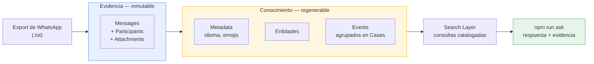
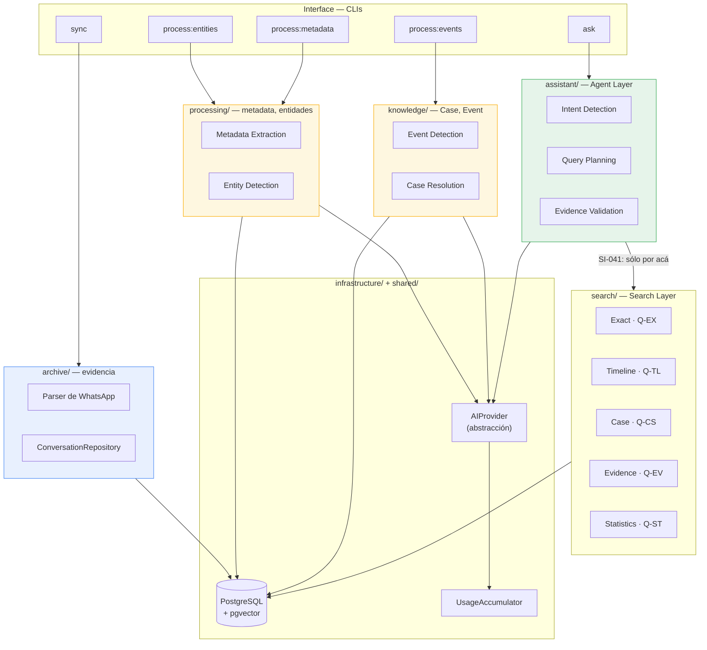
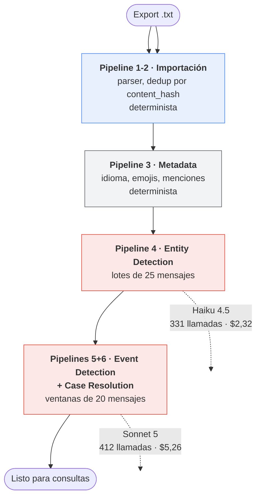
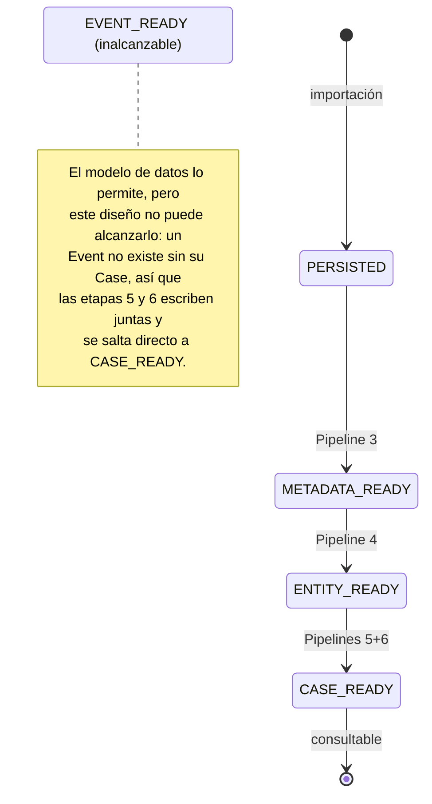
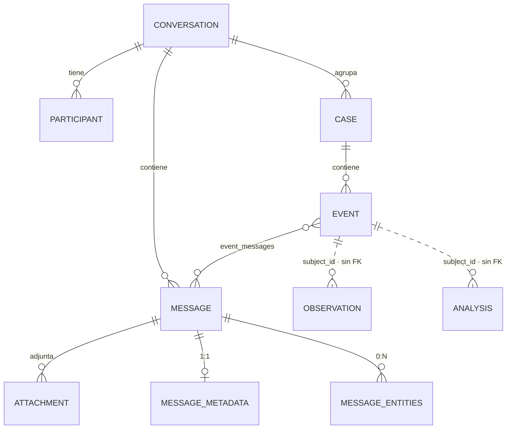
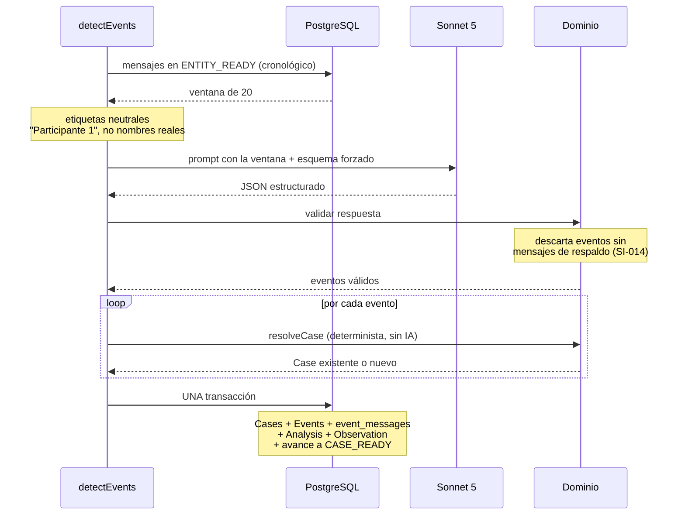
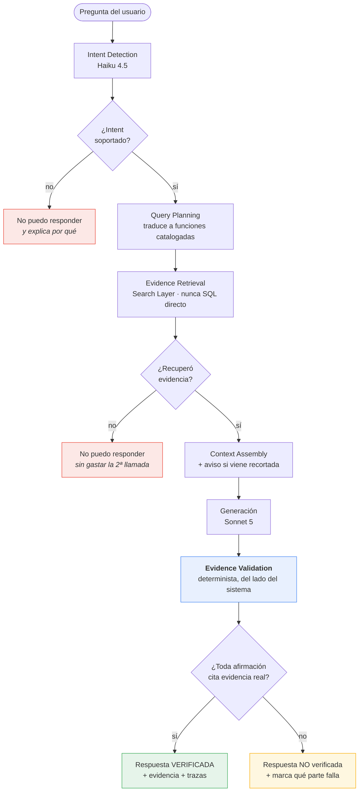
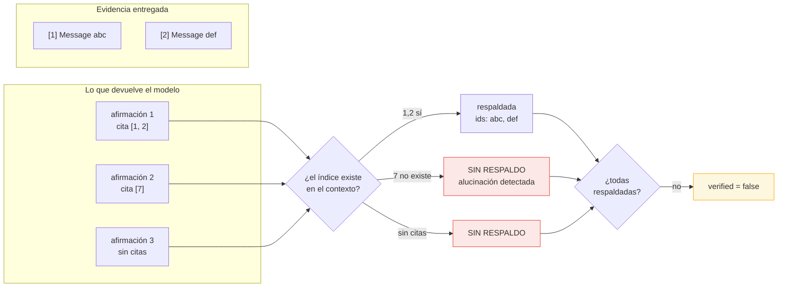
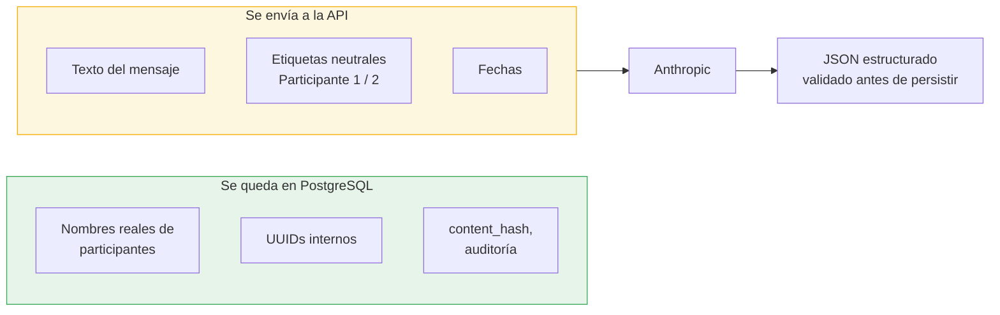
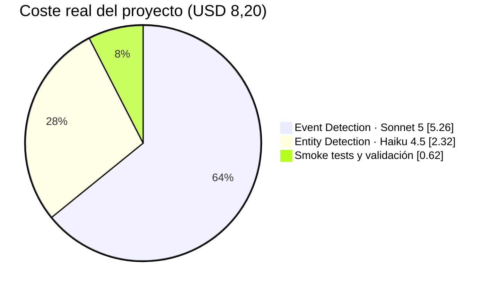

# VISUAL_GUIDE.md

# Conversation Memory Assistant — guía visual

## Propósito

Recorrido visual del sistema, pensado como **primera lectura** antes de
entrar en los documentos de dominio. Cuenta el flujo en secuencia: qué
entra, cómo se convierte en conocimiento, y cómo se responde una pregunta
sin perder la trazabilidad a la evidencia.

Los diagramas están en Mermaid en lugar de imágenes binarias: GitHub los
renderiza igual, pero al ser texto se versionan, se diffean y se editan
sin herramientas externas. Cuando un diagrama y el código discrepen, el
código manda — igual que `docs/DATA_MODEL.md` manda sobre `schema.ts`.

Para reusarlos fuera del repo (una presentación, un PDF, un issue) hay
copias en SVG en [`docs/diagrams/`](diagrams/), **generadas** desde este
archivo con `npm run docs:diagrams`. No se editan a mano: el siguiente
regenerado las pisaría. Si cambias un diagrama, cámbialo aquí y vuelve a
exportar.

Documentos relacionados: `docs/ARCHITECTURE.md` (capas en prosa),
`docs/PIPELINES.md` (etapas), `docs/AGGREGATES.md` (límites de
consistencia), `docs/QUERY_CATALOG.md` (contrato de consultas),
`docs/SYSTEM_INVARIANTS.md` (las reglas que los diagramas anotan).

---

## 1. El sistema de un vistazo

Qué entra, qué produce y con qué se pregunta.

**La distinción de color es la idea central del proyecto.** Lo azul es
evidencia: se escribe una vez y no se toca nunca más (SI-002/003/043,
garantizado por permisos de PostgreSQL, no por convención). Lo amarillo
es interpretación: se puede borrar y regenerar entera sin perder nada
(SI-030). Todo el diseño se sigue de esa frontera.

---

## 2. Arquitectura en capas

**La flecha anotada es la restricción que más forma le da al sistema.**
SI-041: el Agent Layer nunca construye SQL ni decide tablas. Traduce la
intención del usuario a llamadas de funciones catalogadas en
`docs/QUERY_CATALOG.md`. Si una pregunta no se puede expresar con esas
funciones, la respuesta es "no puedo responder" — no un SQL improvisado.

`analysis/` contiene la generación de embeddings (fase 05: chunking,
proveedor Voyage, repositorio y CLI). `api/` existe en el árbol pero
sigue vacío: era para una API REST que todavía no hace falta.

---

## 3. El Pipeline General, etapa por etapa

En rojo, las únicas dos etapas que **gastan saldo real**. Las demás son
deterministas y se pueden reejecutar sin coste. Los importes son los
medidos sobre un corpus real de miles de mensajes, no estimaciones
(`docs/DECISIONS.md`).

Cada etapa es **idempotente y reejecutable por separado** (PL-003/PL-004):
sólo procesa los mensajes que están en el estado anterior, así que una
corrida interrumpida se retoma sin repetir —ni volver a pagar— lo ya
hecho.

---

## 4. Estados de un mensaje

El progreso vive en `message_processing_state`, **nunca** en
`messages.status`: `messages` es evidencia inmutable y sólo llega hasta
`PERSISTED`.

**Por qué `EVENT_READY` quedó inalcanzable** es una de las decisiones
menos obvias del proyecto: `docs/AGGREGATES.md` define `Event` como
entidad interna del agregado `Case` ("Todo Event pertenece a un único
Case") y prohíbe un `EventRepository`. No existe un estado intermedio
válido donde un `Event` esté persistido sin su `Case`. Detalle completo
en `docs/DECISIONS.md`.

Un mensaje que falla la validación de una respuesta de IA **no avanza de
estado**: se queda donde estaba y se reintenta en una corrida futura. Eso
es lo que evita perder trabajo y, a la vez, marcar como procesado algo
que nunca se analizó.

---

## 5. Agregados y frontera de inmutabilidad

Las dos últimas relaciones van punteadas a propósito: `observations` y
`analyses` referencian a su sujeto de forma **polimórfica**
(`subject_type` + `subject_id`, que puede ser un Message, un Event, un
Case o la Conversation), así que **no tienen foreign key**. No es un
matiz académico: por eso mismo sobrevivían a un `TRUNCATE ... CASCADE`
desde `conversations` y contaminaban corridas de tests hasta que se
listaron explícitamente (`docs/DECISIONS.md`).

| Agregado | Root | Mutabilidad | Repositorio |
|---|---|---|---|
| **Conversation** | `Conversation` | Inmutable (SI-002/003/043) | `ConversationRepository` |
| **Case** | `Case` | Regenerable (SI-030) | `CaseRepository` |
| **ImportJob** | `ImportJob` | Mutable — registra el estado del proceso | `ImportJobRepository` |

`Event`, `Insight` y `Relationship` **no tienen repositorio propio**: son
entidades internas del agregado `Case` y se administran sólo desde él
(`docs/AGGREGATES.md` lista `EventRepository` entre los prohibidos).

La tabla puente `event_messages` es la que sostiene SI-014: **todo Event
se respalda en uno o varios Message reales**. Sobre un corpus real de miles de Events
generados hubo **cero** sin evidencia, y ~70% se apoyó en dos o más
mensajes.

La inmutabilidad no es una convención del código: el rol `cma_app` con el
que corre la aplicación **no tiene permiso de `DELETE` ni `UPDATE`** sobre
las cuatro tablas de evidencia. PostgreSQL lo rechaza aunque el código lo
intente.

---

## 6. Event Detection + Case Resolution, en detalle

La etapa más elaborada del pipeline. Una ventana de 20 mensajes
consecutivos, una llamada a la IA, una transacción.

Tres decisiones que no se ven en el diagrama pero lo explican:

- **La ventana no es sólo ahorro de coste.** Una propuesta y su respuesta
  suelen estar en mensajes distintos; analizando de a uno serían
  estructuralmente indetectables. Medido: el 70% de los Events se apoya
  en 2+ mensajes.
- **`occurred_at` sale de la evidencia**, no del modelo: es el `sent_at`
  del primer mensaje que respalda el Event. Una fecha inventada
  contaminaría la cronología sin forma de detectarlo.
- **Case Resolution no gasta una segunda llamada**: es determinista
  (categoría + solapamiento de títulos + cercanía temporal).

---

## 7. Responder una pregunta (Pipeline 12 · UC-014)

**Los dos cortes tempranos en rojo son deliberados**: pedirle una
respuesta al modelo sin evidencia sobre la que apoyarse es invitarlo a
inventarla, y encima pagar por ello. Cuando no hay nada que citar, el
sistema contesta sin llamar al modelo generador.

Un intent puramente semántico ("¿cuándo se puso de mal humor?") ya no cae
en ese corte: desde el cierre de la fase 06 lo resuelve `buscar_por_tema`
vía Semantic Search (Q-SEM-01). SI-036 se sigue respetando en la
dirección contraria — si la pregunta trae una palabra ancla literal, va
por Exact Search, no por similitud. Lo que sí sigue cayendo en el primer
corte es lo que ninguna búsqueda resuelve: opiniones, juicios de valor y
predicciones.

---

## 8. Cómo se verifica una respuesta

El paso que distingue a este sistema de un chatbot sobre documentos.

Dos decisiones que sostienen esto:

- **Que el modelo declare "tengo evidencia suficiente" no basta.** Una
  respuesta se marca verificada sólo si además la comprobación
  determinista confirma que cada afirmación cita evidencia que
  efectivamente se le entregó. Pedirle al modelo que se autoevalúe no
  sirve como control: si se equivocó al responder, puede equivocarse
  igual al revisarse.
- **Una afirmación sin respaldo se devuelve marcada, no borrada.** Así se
  ve *qué parte* no está sustentada, en vez de recibir un texto recortado
  sin explicación.

Las estadísticas (`¿cuántos mensajes hay?`) son evidencia citable de tipo
`Statistic`: no se prueban con un mensaje concreto, pero se verifican
recalculando la consulta. Sin esa categoría, toda respuesta agregada
correcta saldría marcada como no respaldada — y un aviso que salta en
respuestas correctas enseña al usuario a ignorarlo.

---

## 9. Qué sale hacia la API de Anthropic

Relevante porque una conversación puede incluir datos de terceros reales,
menores incluidos (`rules/security-privacy.md`).

El texto del mensaje sí viaja — es inevitable para poder analizarlo — pero
**los nombres reales no**: el modelo no los necesita para clasificar, y la
atribución se reconstruye después desde `event_messages` →
`messages.participant_id`, que es evidencia local. De paso, gasta menos
tokens.

El contenido se trata como entrada **no confiable** en ambos sentidos: se
neutralizan los delimitadores del prompt antes de enviarlo (para que un
mensaje no pueda fabricar estructura y hacer que se atribuyan datos al
mensaje equivocado), y toda respuesta se valida campo a campo antes de
persistir (`docs/SECURITY.md`).

---

## 10. Dónde se gasta el dinero

| Etapa | Modelo | Por qué ese modelo |
|---|---|---|
| Entity Detection | Haiku 4.5 | Extracción de campos objetivos, baja ambigüedad, altísimo volumen |
| Intent Detection | Haiku 4.5 | Clasificación en 7 categorías, error barato de corregir |
| Event Detection | Sonnet 5 | Interpretación de matices; un evento mal clasificado alimenta Cases e Insights |
| Generación de respuestas | Sonnet 5 | Va dirigido al usuario y debe sostenerse sobre la evidencia |

Dos decisiones bajaron el coste de una estimación inicial de $25–35 a los
$8,20 reales:

- **Agrupar mensajes por llamada.** Con mensajes de 40 caracteres de
  promedio, una llamada por mensaje gastaba la mayor parte de los tokens
  repitiendo las instrucciones. La caché de prompt no servía: el mínimo
  cacheable de Haiku 4.5 son 4.096 tokens y el prefijo no llega.
- **Razonamiento del modelo apagado por defecto.** En Sonnet 5 viene
  activado y sus tokens se facturan como salida; sobre miles de mensajes
  no es marginal. Queda como palanca explícita (`--thinking`) para
  corridas acotadas donde la calidad importe más que el coste.

---

## Objetivo

Que alguien que llega al proyecto entienda, sin leer código, por qué la
evidencia y la interpretación viven separadas, por qué el agente no puede
consultar la base de datos directamente, y por qué una respuesta puede
venir marcada como no verificada aunque suene razonable.
