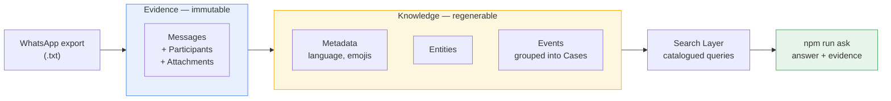
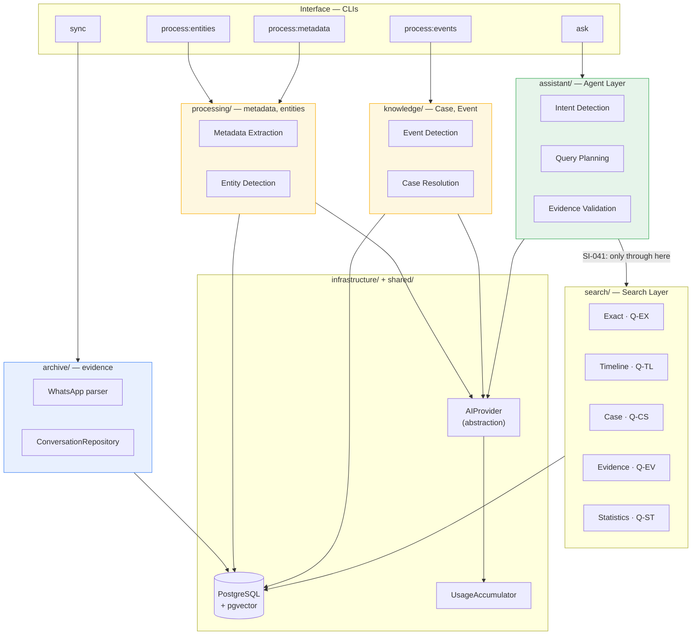
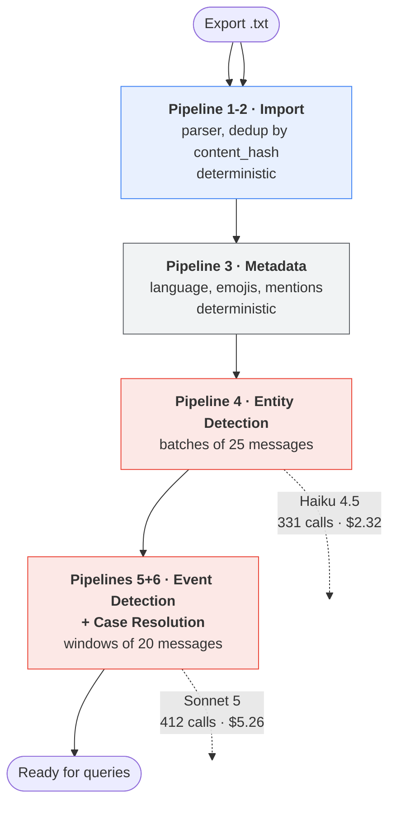
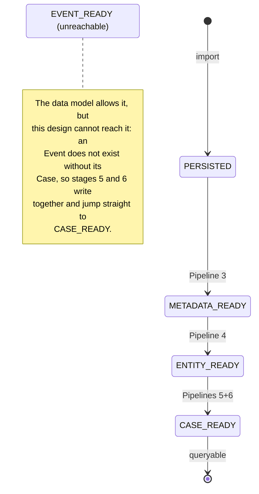
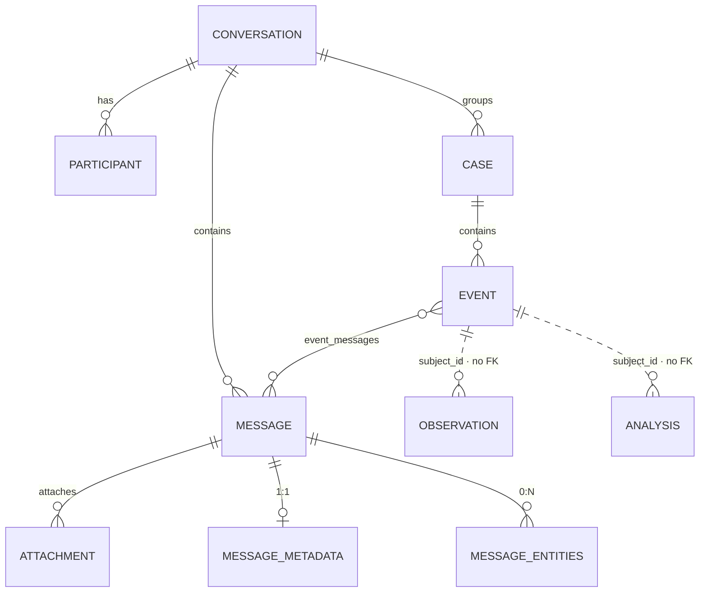
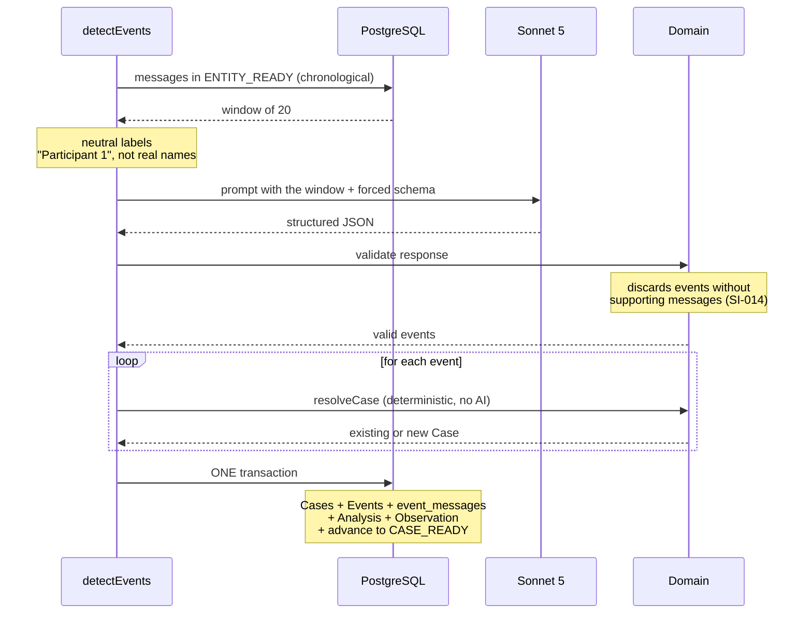
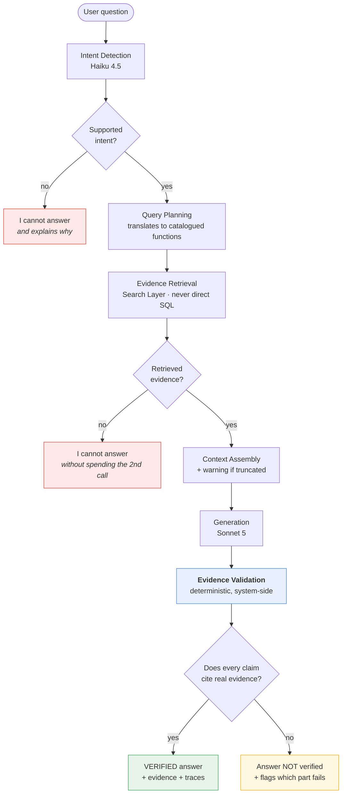
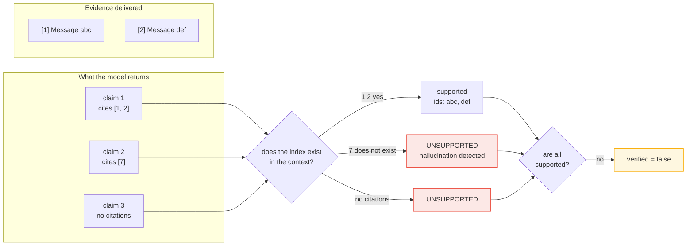
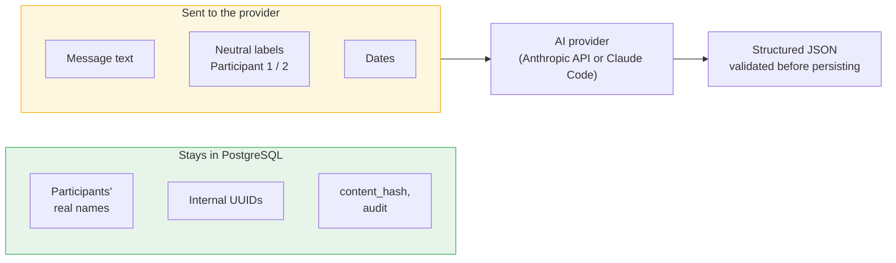
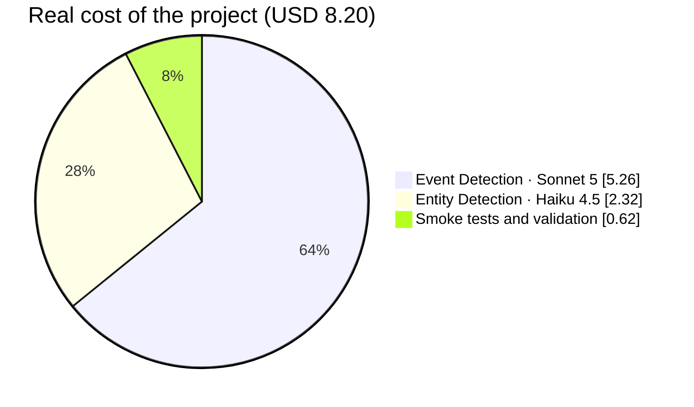

# VISUAL_GUIDE.md

[Español](../VISUAL_GUIDE.md) · **English**

# WhatsApp Memory Search — visual guide

## Purpose

A visual walkthrough of the system, meant as the **first read** before going
into the domain documents. It tells the flow in sequence: what comes in, how
it becomes knowledge, and how a question is answered without losing
traceability to the evidence.

The diagrams are in Mermaid rather than binary images: GitHub renders them
the same, but being text they are versioned, diffed and edited without
external tools. When a diagram and the code disagree, the code wins — just
as `docs/DATA_MODEL.md` wins over `schema.ts`.

SVG copies for reuse outside the repo (a presentation, a PDF, an issue) are
in [`docs/diagrams/`](../diagrams/), **generated** from the Spanish
`docs/VISUAL_GUIDE.md` with `npm run docs:diagrams`. They are not edited by
hand: the next regeneration would overwrite them.

Related documents: [`ARCHITECTURE.md`](ARCHITECTURE.md) (layers in prose),
[`PIPELINES.md`](PIPELINES.md) (stages),
[`AGGREGATES.md`](AGGREGATES.md) (consistency boundaries),
[`QUERY_CATALOG.md`](QUERY_CATALOG.md) (query contract),
[`SYSTEM_INVARIANTS.md`](SYSTEM_INVARIANTS.md) (the rules the diagrams
annotate).

---

## 1. The system at a glance

What comes in, what it produces and what you ask with.

**The color distinction is the central idea of the project.** Blue is
evidence: it is written once and never touched again (SI-002/003/043,
guaranteed by PostgreSQL permissions, not by convention). Yellow is
interpretation: it can be deleted and regenerated in full without losing
anything (SI-030). The whole design follows from that boundary.

---

## 2. Layered architecture

**The annotated arrow is the constraint that shapes the system the most.**
SI-041: the Agent Layer never builds SQL or decides tables. It translates the
user's intent into calls to functions catalogued in
`docs/QUERY_CATALOG.md`. If a question cannot be expressed with those
functions, the answer is "I cannot answer" — not improvised SQL.

`analysis/` contains embedding generation (chunking, the Voyage provider,
repository and CLI). `api/` exists in the tree but is still empty: it was
meant for a REST API that is not needed yet.

---

## 3. The General Pipeline, stage by stage

In red, the only two stages that use **AI resources** (API balance or
subscription quota, depending on the engine). The others are deterministic
and can be re-run at no cost. The amounts are those measured on a real
corpus of thousands of messages with the Anthropic API, not estimates.

Every stage is **idempotent and can be re-run separately** (PL-003/PL-004):
it only processes messages that are in the previous state, so an interrupted
run resumes without repeating —or paying again for— what was already done.

---

## 4. States of a message

Progress lives in `message_processing_state`, **never** in
`messages.status`: `messages` is immutable evidence and only goes as far as
`PERSISTED`.

**Why `EVENT_READY` became unreachable** is one of the least obvious
decisions in the project: `docs/AGGREGATES.md` defines `Event` as an
internal entity of the `Case` aggregate ("Every Event belongs to a single
Case") and forbids an `EventRepository`. There is no valid intermediate
state where an `Event` is persisted without its `Case`.

A message that fails validation of an AI response **does not advance in
state**: it stays where it was and is retried in a future run. That is what
avoids both losing work and marking as processed something that was never
analyzed.

---

## 5. Aggregates and the immutability boundary

The last two relationships are dotted on purpose: `observations` and
`analyses` reference their subject **polymorphically** (`subject_type` +
`subject_id`, which can be a Message, an Event, a Case or the Conversation),
so they **have no foreign key**. This is not an academic nuance: it is why
they used to survive a `TRUNCATE ... CASCADE` from `conversations` and
contaminate test runs until they were listed explicitly.

| Aggregate | Root | Mutability | Repository |
|---|---|---|---|
| **Conversation** | `Conversation` | Immutable (SI-002/003/043) | `ConversationRepository` |
| **Case** | `Case` | Regenerable (SI-030) | `CaseRepository` |
| **ImportJob** | `ImportJob` | Mutable — records process state | `ImportJobRepository` |

`Event`, `Insight` and `Relationship` **have no repository of their own**:
they are internal entities of the `Case` aggregate and are managed only
through it (`docs/AGGREGATES.md` lists `EventRepository` among the forbidden
ones).

The `event_messages` join table is what upholds SI-014: **every Event is
backed by one or more real Messages**. Across a real corpus with thousands
of generated Events there were **zero** without evidence, and ~70% were
backed by two or more messages.

Immutability is not a code convention: the `cma_app` role the application
runs with **has no `DELETE` or `UPDATE` permission** on the four evidence
tables. PostgreSQL rejects it even if the code tries.

---

## 6. Event Detection + Case Resolution, in detail

The most elaborate stage of the pipeline. A window of 20 consecutive
messages, one call to the AI, one transaction.

Three decisions that are not visible in the diagram but explain it:

- **The window is not only cost savings.** A proposal and its reply are
  often in different messages; analyzing one at a time they would be
  structurally undetectable. Measured: 70% of Events are backed by 2+
  messages.
- **`occurred_at` comes from the evidence**, not from the model: it is the
  `sent_at` of the first message that backs the Event. An invented date
  would contaminate the timeline with no way to detect it.
- **Case Resolution does not spend a second call**: it is deterministic
  (category + title overlap + time proximity).

---

## 7. Answering a question (Pipeline 12 · UC-014)

**The two early cut-offs in red are deliberate**: asking the model for an
answer with no evidence to rest on invites it to invent one, and you pay for
it too. When there is nothing to cite, the system answers without calling
the generating model.

A purely semantic intent ("when did they lose their temper?") no longer
falls into that cut-off: `buscar_por_tema` resolves it through Semantic
Search (Q-SEM-01). SI-036 is still respected in the opposite direction — if
the question contains a literal anchor word, it goes through Exact Search,
not through similarity. What still falls into the first cut-off is what no
search can resolve: opinions, value judgments and predictions.

---

## 8. How an answer is verified

The step that sets this system apart from a chatbot over documents.

Two decisions that support this:

- **The model declaring "I have enough evidence" is not enough.** An answer
  is marked verified only if the deterministic check also confirms that every
  claim cites evidence that was actually delivered to the model. Asking the
  model to evaluate itself does not work as a control: if it was wrong when
  answering, it can be equally wrong when reviewing itself.
- **An unsupported claim is returned flagged, not deleted.** That way you can
  see *which part* is not supported, instead of receiving trimmed text with
  no explanation.

Statistics (`how many messages are there?`) are citable evidence of type
`Statistic`: they are not proven with a specific message, but they are
verified by recomputing the query. Without that category, every correct
aggregate answer would come out flagged as unsupported — and a warning that
fires on correct answers teaches the user to ignore it.

---

## 9. What goes out to the AI provider

Relevant because a conversation can include data about real third parties,
minors included (`.claude/rules/security-privacy.md`).

The message text does travel — it is unavoidable in order to analyze it —
but **real names do not**: the model does not need them to classify, and
attribution is reconstructed later from `event_messages` →
`messages.participant_id`, which is local evidence. It also spends fewer
tokens.

Content is treated as **untrusted** in both directions: the prompt
delimiters are neutralized before sending (so a message cannot fabricate
structure and cause data to be attributed to the wrong message), and every
response is validated field by field before persisting
([`SECURITY.md`](SECURITY.md)).

---

## 10. Where the money goes

| Stage | Model | Why that model |
|---|---|---|
| Entity Detection | Haiku 4.5 | Extraction of objective fields, low ambiguity, very high volume |
| Intent Detection | Haiku 4.5 | Classification into 7 categories, a cheap error to fix |
| Event Detection | Sonnet 5 | Interpretation of nuance; a misclassified event feeds Cases and Insights |
| Answer generation | Sonnet 5 | Addressed to the user and must stand on the evidence |

Two decisions brought the cost down from an initial estimate of $25–35 to
the real $8.20:

- **Grouping messages per call.** With messages averaging 40 characters, one
  call per message spent most of its tokens repeating the instructions.
  Prompt caching did not help: the cacheable minimum for Haiku 4.5 is 4,096
  tokens and the prefix does not reach it.
- **Model reasoning off by default.** In Sonnet 5 it is on by default and its
  tokens are billed as output; over thousands of messages it is not
  marginal. It remains an explicit lever (`--thinking`) for bounded runs
  where quality matters more than cost.

(These figures were measured with the Anthropic API. With the default
`claude-code` engine there is no per-token charge: see
[`AI_PROVIDERS.md`](AI_PROVIDERS.md).)

---

## Goal

That someone arriving at the project understands, without reading code, why
evidence and interpretation live apart, why the agent cannot query the
database directly, and why an answer may come back flagged as unverified even
though it sounds reasonable.
